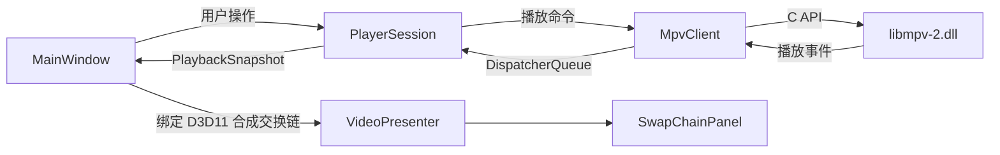

# IIMA

IIMA 是以 IINA 开源源码为直接依据的 Windows 移植项目。阅读、复用和转写 IINA 的实现是默认研发方式。项目以 IINA 的实际代码为行为基准，延续可移植的业务逻辑、状态模型和交互规则。

- 界面固定采用 C++/WinRT 和 WinUI 3，播放由 libmpv 提供。窗口管理、图形呈现和系统集成按需使用 Win32、D3D11、DXGI 等 Windows 接口。
- 涉及 Rust、Electron、WebView 或其他技术栈的架构变更，须由项目维护者明确决定。
- 移植交互时，先从 IINA 的实现确认状态、事件条件和操作结果，再将这些行为映射到合适的 Windows 控件。
- IINA 的插件 API、脚本运行时、加载器、管理界面和扩展入口均在移植范围之外。所需功能直接在 IIMA 中通过 Windows 原生方式实现。

## 目录结构

```text
IIMA/
├── src/
│   ├── IIMA.App/           WinUI 3 界面、Windows 集成和视频呈现
│   │   ├── Platform/       注册表、文件、进程和系统媒体接口
│   │   ├── Presentation/   D3D11/DXGI 交换链与 XAML 视频面板
│   │   ├── Settings/       偏好和媒体预设的 JSON 转换
│   │   └── Strings/        简体中文与 English 的语言资源
│   └── IIMA.Core/          播放会话、业务规则及 libmpv 适配
├── build/                  构建配置、WinUI 生成、安装器和媒体补丁
├── scripts/                本地编译、依赖恢复、SDK 校验和打包入口
├── references/
│   ├── iina/               IINA 上游源码快照
│   └── mpv/                mpv 上游源码快照
├── docs/                   架构、依赖和构建文档
└── .github/workflows/      Windows 构建验证
```

根目录的 `CMakeLists.txt` 定义构建入口，`CMakePresets.json` 提供 Debug 和 Release 预设，`NuGet.Config` 配置包源。构建中间文件集中在 `.build/`，ZIP、MSI 和版本文件输出到 `.dist/`。

## 架构

| 模块 | 职责 |
| --- | --- |
| [`IIMA.App`](src/IIMA.App) | 构建为 `IIMA.exe`，并静态链接 `IIMA.Core`。`Main.cpp` 初始化进程和语言资源，`App` 管理播放器窗口及打开请求。`MainWindow` 连接 XAML、用户操作和播放会话。 |
| [`IIMA.Core`](src/IIMA.Core) | 构建为 C++ 静态库。`PlayerSession` 管理窗口对应的播放会话和状态快照，其余目录管理播放列表、字幕、历史、输入、偏好等业务规则。`MpvClient` 负责命令队列与 libmpv 事件。 |
| [媒体运行时](build/patches) | 应用在运行时加载 `libmpv-2.dll`。解码、音视频输出和轨道处理由 libmpv 完成。IIMA 的补丁提供 D3D11 合成交换链，由 `VideoPresenter` 绑定到 WinUI 的 `SwapChainPanel`。 |

播放器操作和状态更新经过以下路径。mpv 事件通过 `DispatcherQueue` 回到 UI 线程，`PlayerSession` 更新 `PlaybackSnapshot` 后由窗口刷新控件。



各子目录的职责和具体代码入口见[架构与模块](docs/architecture.md)。

## 构建

依赖安装、编译和打包步骤见[依赖与构建](docs/build.md)。
