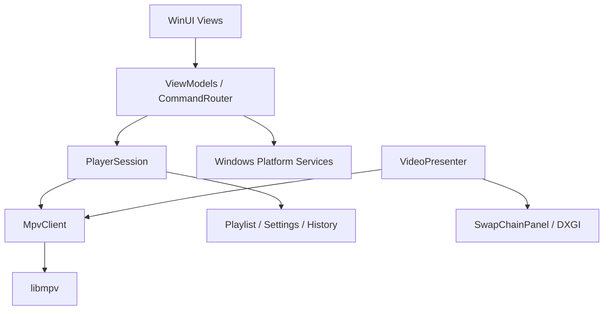

# IIMA 基础架构

状态：开发分支已实现 XAML 页面、MpvClient、PlayerSession 与拥有型呈现适配；Windows 编译/运行未验证，已写入安全交换链生产补丁与绑定握手，但尚无实际 Windows 播放证据。日期：2026-11-11。

本文定义模块职责与实现约束。当前实际入口见 [BUILD.md](BUILD.md)；模块以实际代码为准；本批已接入 XAML 编译配置，但生成链未在 Windows 运行。开发约定见 [AGENTS.md](../AGENTS.md)，执行顺序见 [HANDOFF.md](HANDOFF.md)。

## 目标与边界

- 交付兼容 Windows 11 的 x64 原生桌面应用，采用 C++/WinRT、WinUI 3、MSVC 和 MSBuild。
- 以 IINA 源码为移植依据，直接转写适用逻辑，按 Windows 机制替换平台相关实现。
- libmpv 负责音视频播放与字幕渲染，按上游支持方式构建。IIMA 不重新实现解码器或字幕引擎。
- 以当前稳定依赖为选型起点，在工程建立时核对并固定具体版本；不将参考快照或某次讨论中的版本自动视为运行依赖版本。
- 不维护其他系统和架构的兼容层，也不添加仅用于阻止其他系统运行的检查。
- 首个可用版本聚焦本地文件播放。IINA 插件兼容、在线字幕服务、浏览器集成和多窗口体验属于后续独立功能，不在基础设施阶段提前实现。此安排不缩减长期移植目标。

## 工程组织

采用一个应用工程和一个原生静态库，按职责组织源码，避免把每个模块拆成 DLL 或独立服务。

```text
IIMA.sln                         # MSBuild 解决方案
Directory.Build.props            # 共享编译设置与输出路径
src/
  IIMA.App/                      # WinUI C++/WinRT 应用工程
    Views/                       # 窗口、控制栏、播放列表与设置页面
    ViewModels/                  # XAML 绑定及 UI 状态投影
    Presentation/                # SwapChainPanel 与视频呈现适配
    Platform/                    # Windows 文件、窗口、激活、媒体键接口
    Resources/                   # 图标、样式和本地化资源
    App.xaml
    MainWindow.xaml
  IIMA.Core/                     # 原生 C++ 静态库，无 XAML 依赖
    Playback/                    # 播放会话、命令与状态模型
    Mpv/                         # libmpv C API 封装、事件读取
    Playlist/                    # 播放列表业务规则
    Settings/                    # 设置结构、默认值、读写
    History/                     # 历史与续播位置
    Diagnostics/                 # 必要日志与错误上下文
build/
  DEPENDENCIES.md                 # 当前依赖与来源说明（精确包版本见 packages.config）
  props/                         # 依赖路径和链接配置
scripts/                         # 获取依赖、构建、打包入口
tests/                          # 实际需要的原生逻辑与集成测试
docs/                           # 架构、交接和验证记录
references/                     # 固定源码参考快照，纳入 Git
.deps/                          # 本机依赖产物，不纳入 Git
artifacts/                      # 编译、测试和分发输出，不纳入 Git
```

目录按实现需要创建，不批量生成空类或占位接口。测试工程随首批有价值的测试建立。Core 无需设计成跨平台框架，可以使用必要的 Windows 能力；但不得包含 WinUI 控件或窗口对象。

## 模块职责与依赖方向



事件从 libmpv 经 MpvClient 回到 PlayerSession，再更新 ViewModel；界面不直接调用 mpv。图中的 VideoPresenter 通过范围有限的呈现访问接口取得交换链，不能任意操作播放状态。

| 模块 | 负责 | 不负责 |
|---|---|---|
| App / Window | 启动、窗口生命周期、组装依赖、外部打开请求 | 解码和播放状态判断 |
| CommandRouter / ViewModels | 将菜单、快捷键、控制栏及系统命令映射到统一操作，投影可绑定状态 | 维护另一套播放器真相 |
| PlayerSession | 单次播放器会话、命令协调、状态转换、事件关联 | XAML 控件和 DXGI 调用 |
| MpvClient | 句柄、选项、异步命令、属性观察、事件复制、错误转换 | 产品 UI 规则 |
| VideoPresenter | 呈现对象绑定、物理像素尺寸、重新绑定和解除绑定 | 业务播放列表与设置存储 |
| Playlist | 加入、移除、排序、上一项下一项规则 | 独立推进另一套播放队列 |
| Settings / History | 设置与历史记录持久化、默认值和格式版本 | 直接控制界面 |
| Platform | 文件选择、拖放、文件激活、全屏、系统媒体控制、防休眠 | 重新封装所有 Windows API |

首阶段一个窗口对应一个 PlayerSession，一个会话拥有一个主 mpv_handle。应用组合根明确持有对象，不使用全局可变播放器单例。未来增加窗口时再增加会话实例，不提前设计会话管理框架。

## 命令与状态

- 公开应用级操作：Open、Play、Pause、Seek、Stop、SelectTrack、SetVolume、SetSpeed，以及播放列表操作。以实际用到的方法形成接口，不先建立通用消息总线。
- 快捷键、菜单、按钮和系统媒体键进入同一命令入口，避免行为分叉。
- libmpv 是实际播放状态的权威来源。命令返回成功只代表请求被接受，不代表文件已载入或 seek 已完成。
- PlayerSession 保存已确认的播放快照；ViewModel 可以持有拖动中的进度、菜单展开等临时 UI 状态，不回写为已确认播放状态。
- 会话生命周期至少区分 Initializing、Ready、Closing、Closed、Failed；媒体状态另分 Empty、Loading、Loaded、Ended、Error。暂停、缓冲、seek 作为独立字段，避免用一个枚举表达所有组合。
- duration、time position、轨道等可以未知。不能把未知时长当成零秒且可拖动的视频。
- 属性变化推动更新；高频进度更新可合并，终止、错误、文件切换事件不得被丢弃。不要为所有状态增加 UI 定时轮询。
- 异步命令使用请求 ID 关联结果；媒体切换依据上游事件顺序与条目标识关联。后台缩略图、历史加载等使用媒体代次取消或丢弃过期结果，不能仅给所有迟到事件贴上当前代次。
- mpv 的 playlist 属性作为实际播放队列依据；应用层提供编辑策略并对照事件更新 UI，不维护独立自动前进的队列。

## 线程、内存与关闭

- UI 线程拥有 XAML 对象、ViewModel 和 PlayerSession 的应用状态变更。后台事件经 DispatcherQueue 投递；同步阻塞操作不得放在 UI 线程。
- 每个主 mpv_handle 只有一个事件消费者。MpvClient 的工作线程读取事件，并在下一次 mpv_wait_event 前深拷贝需要保留的数据，不能向 UI 发送借用的 event/node 指针。
- 命令提交与句柄销毁按统一生命周期规则协调，关闭后拒绝新命令。使用 mpv 异步接口，避免 UI 等待加载和 seek。
- 合成输出模式由 mpv 管理内部渲染线程；应用不再创建一个逐帧轮询的渲染循环。若改用 Render API，单独定义其线程和同步规则。
- 异步 lambda 使用适当的弱引用或可验证的生存期；UI 投递失败、窗口已关闭时安全丢弃消息。不要通过长期持有窗口强引用阻止退出。
- 主句柄由 MpvClient 唯一负责销毁；交换链、订阅和系统资源使用 RAII。分别确认借用和拥有的接口，禁止凭指针值猜测所有权。

关闭顺序必须实现并验证：

1. 将会话置为 Closing，拒绝新命令，取消预览等后台任务。
2. 在 UI 仍可调度时解除呈现绑定和 UI 订阅；确认应用不再访问交换链。Render API 路线还需先结束渲染并销毁 render context。
3. 唤醒并停止应用的事件消费者，确保其退出且不再调用该句柄；不得在 UI 线程等待一个反向依赖 UI 调度的工作线程。
4. 在非 UI 的收尾路径按 libmpv 契约终止并销毁句柄，释放应用持有的图形引用及剩余资源。
5. 允许窗口和应用退出。处理用户关闭与 mpv 主动 shutdown 两条路径，关闭操作保持幂等。

具体同步实现以所选 libmpv 头文件为准；不得在事件读取和句柄销毁之间制造并发访问。

## 视频呈现决策

首选原型方向：libmpv 的 `gpu-next` + D3D11 composition 输出，取得交换链后绑定 WinUI SwapChainPanel。当前参考快照包含 `d3d11-output-mode`、`display-swapchain` 和 `d3d11-composition-size`，但它们在最终选定的二进制中的可用性与表现仍需运行验证。

- Presenter 负责把逻辑尺寸与缩放换算成实际输出像素，响应控件尺寸、DPI 和窗口状态变化。
- 交换链可能未建立或在切换中重建；不能在启动时读取一次后永久缓存裸指针。核对上游创建、失效和通知机制，完成重新绑定及引用生命周期处理。
- 合成接口返回进程内地址，不能用启动独立 mpv.exe 加普通 IPC 的方式传递该地址来替代进程内 libmpv 集成。
- UI 控件叠加、HDR 输出、跨屏色彩和窗口透明效果分别验证；不要把普通 XAML 叠加等同于支持视频背景模糊。
- 不默认宣称零复制；硬件解码与复制路径通过实际信息或日志确认。
- 若首选路径存在阻断，先记录证据和影响，再评估 D3D11 Render API 等替代方案。Render API 不自动等价于 `gpu-next`；不能悄悄换路后仍宣称原目标成立。

首个呈现原型需覆盖：视频及声音、播放暂停、进度跳转、XAML 控制栏叠加、连续缩放、全屏往返、换片、关闭。HDR、不同 DPI/刷新率显示器、显卡设备变化按后续验收验证；缺少硬件必须标记未验证。

## 数据、配置与错误

- 默认用户数据位置为 `%LOCALAPPDATA%\IIMA\`，配置、历史和日志分开存储，不写入程序安装目录。
- 初期设置与历史采用带 schemaVersion 的 JSON 文件，临时文件加替换写入；损坏文件保留以便诊断，加载默认设置并给出适当反馈。JSON 实现库在工程建立时选择一个并固定版本。
- 设置由类型化模型提供默认值、范围和适用时机，区分可即时修改与需要重新建立会话的选项。
- 初期由 IIMA 保存续播位置；不同时启用另一套独立续播写入机制。与 mpv watch-later 兼容属于后续明确任务。
- 路径在 Windows 边界按 Unicode 处理，在 mpv C API 边界按其 UTF-8 要求转换；测试中文、空格和特殊字符文件名。
- 默认不加载未声明的全局 mpv 配置或外部脚本，保证 IIMA 默认行为可重复。以后引入高级配置时明确覆盖顺序。
- 日志包含依赖版本、渲染路径、关键错误和关闭过程，控制体积；避免默认记录凭据、完整带令牌 URL 或整份用户配置。不搭建遥测服务。
- 区分文件打不开、依赖缺失、图形初始化失败和用户取消，保留错误上下文。错误信息不能仅显示底层数值。

## 构建与交付

- 采用 Visual Studio C++/WinRT 工程和 MSBuild 解决方案，Debug/Release 均只建立 x64 配置。IIMA 自有代码统一采用 C++23；核对并固定 MSVC 的对应标准模式及实际使用特性的支持情况，不使用浮动的 latest 模式。第三方依赖遵循上游的语言标准要求，遇到工具链约束时记录问题，不擅自降级。
- 工程建立时固定 MSVC toolset、Windows SDK、Windows App SDK、C++/WinRT 包、libmpv 及新增依赖的真实版本；记录获取方式和最低 Windows build 要求，不把某一 Windows 11 更新分支的能力默认为所有 Windows 11 都有。
- 不修改参考快照来构建生产库。libmpv 的获取/构建在独立目录进行，优先采用上游支持的构建流程。
- 主程序通过 libmpv 的 C ABI 接入。确认实际 DLL 导出与头文件一致，提供 MSVC 可用的导入库；不能直接假定其他工具链的导入库可被 MSVC 链接器使用。
- 各方在各自 API 规定的释放函数中释放内存，不跨 CRT 随意 free/delete。不得跨依赖边界传递 C++ STL 对象或异常。
- 开发及首个可测试产物以非 MSIX 的应用目录为基线，内含 IIMA.exe、libmpv 及必要依赖。优先验证 Windows App SDK 自包含部署；自包含不代表无需考虑 VC++ 运行库等其他依赖。
- 分发包在无开发工具的 Windows 11 x64 环境验证；完整目录可打包为 ZIP。正式安装器、签名、文件关联注册及更新策略在分发阶段落实，不在架构阶段虚构证书、商店身份或更新服务器。
- `.deps/`、`artifacts/`、`.vs/` 和生成文件由实现阶段的 .gitignore 排除；源码参考、工程、脚本、依赖清单与文档纳入版本管理。
- 保留版权和许可信息；项目根许可证与分发所需的依赖源码/许可材料在对外发行前落实。

## 源码映射起点

下列入口已在当前快照确认存在；它们是阅读起点，不代表整个文件均可直接转写。

| IINA 源码（相对 references/iina/iina） | IIMA 目标职责 |
|---|---|
| `PlayerCore.swift` | PlayerSession、打开文件和命令协调 |
| `PlaybackInfo.swift` | 播放快照、状态转换和 UI 投影 |
| `MPVController.swift` | MpvClient、属性观察和事件处理 |
| `MPVCommand.swift` / `MPVOption.swift` / `MPVProperty.swift` | 按需提取命令与属性映射 |
| `MainWindowController.swift` / `PlayerWindowController.swift` | 窗口和交互行为 |
| `VideoView.swift` | 呈现行为参考；Windows 图形实现重新适配 |
| `PlaylistViewController.swift` | 播放列表操作与交互 |
| `QuickSettingViewController.swift` / `Preference.swift` | 设置语义、默认值及 UI |
| `KeyMapping.swift` | 快捷键解析与命令映射 |
| `HistoryController.swift` | 历史与续播规则 |
| `AppDelegate.swift` | 启动及外部打开请求语义 |

mpv 阅读入口：`include/mpv/client.h`、`include/mpv/render.h`、`include/mpv/render_d3d11.h`、`DOCS/man/options.rst`、`DOCS/man/input.rst`。实现阶段查阅实际调用的契约及相关实现，避免只根据名称推断行为。

参考版本由 [iina-source.txt](../references/iina-source.txt) 和 [mpv-source.txt](../references/mpv-source.txt) 统一记录。每项移植补充源符号、目标模块、保留行为、Windows 差异及验证结果；不要求为简单函数逐个建立文档。

## 决策状态

已确定：平台、主程序工具链、源码移植方式、参考快照管理、模块职责、单会话起步、事件驱动状态、依赖与参考分离。

已实现待运行验证：`gpu-next` 合成路径、私有 owned-swapchain 协议、控制/播放列表/轨道/历史及系统媒体集成。仍待专项验证：设备重建、HDR/跨屏表现、干净 Windows 环境部署。

当前工具链和原生包版本已经固定，见 BUILD.md；libmpv 版本、JSON 库、测试框架、后续 API 的最低系统要求、正式安装与签名方案由接手研发者在对应阶段落实。不能把未确定事项写成当前已有能力。

官方接口资料：

- [WinUI 3](https://learn.microsoft.com/windows/apps/winui/)
- [SwapChainPanel](https://learn.microsoft.com/windows/windows-app-sdk/api/winrt/microsoft.ui.xaml.controls.swapchainpanel)
- [Windows App SDK 部署](https://learn.microsoft.com/windows/apps/package-and-deploy/deploy-overview)
- [libmpv 头文件](https://github.com/mpv-player/mpv/tree/master/include/mpv)

本地快照和实际选定依赖的接口契约优先于不匹配版本的在线示例。

## 多窗口静态扩展（2026-11-12）

App持有以单调ID索引的MainWindow强引用集合，并以UI线程PlayerWindowRegistry选择激活目标；单窗口异步关闭完成后才从集合移除。窗口各自拥有播放器/图形/系统媒体资源，关闭一个窗口不停止全局InstanceRouter。并发UserData保存使用窗口基线差分合并，IO锁中读取最新磁盘，避免整份旧快照覆盖其他窗口；UI暂不实时同步其他窗口偏好。此扩展尚未编译或运行验证，不撤销原验收条件。

## 自动窗口尺寸事件边界（2026-11-12）

PlayerSession 的 mediaGeneration 仅在实际 START_FILE 递增，与暂停策略代次分离；
mediaOpenIntentRevision 用于立即取消旧 UI 工作。明确 Open 来源由 loadfile 唯一新 entry 回复
及启动事件共同确定，不由 Loaded/path 推断。窗口独立有界状态机消费每代一次，
只读播放快照，原生用户窗口操作优先。视频输出独立修订避免码率/进度驱动几何重试。
已支持首视频几何例外、后续媒体保持画面面积和播放中可信尺寸变化；首次 PLAYBACK_RESTART
之后进行带请求ID、媒体代数及意图修订关联的异步输出读取，成功后才武装重配置。
每次实际显示尺寸变化最多应用一次，窗口拖动期间丢弃请求。
Cocoa 布局偏好触发的 keepWindowSize 没有伪造对应 Windows 控件；其保持面积运算已有真实媒体切换消费者。

## 比例反馈与全屏内存目标（2026-11-12）

PlayerSession 独立协调 window-scale 的外部观察、本地最新目标与写入/异步读回屏障；
UI只提交真实视口比例，不能将请求值当已观察值。相同失败目标受抑制，不随播放快照重试。
全屏模块保存原 presenter 与普通还原几何，自动尺寸计算可写此内存目标，但不会移动实际
全屏窗口。退出前确定目标显示器，恢复普通几何再恢复最大化。音乐/PIP/Fit转换共用全屏退出，
不保留会在未来意外应用的旧全屏目标。上述行为仍未获得原生运行证据。

## 原生菜单状态投影（2026-11-12）

MenuBar为应用层快照投影，点击复用已有typed session或ApplicationCommand入口。
动态菜单带媒体代数和项目身份，展开时冻结，关闭后以一次UI调度刷新，避免命中目标被换片替换。
观察状态决定勾选；菜单不保存另一套播放真相，不额外接管用户快捷键。菜单在Root外部单独布局，
必须独立遵守裁剪事务、关闭和用户数据就绪保护；CompactOverlay隐藏。尚未原生验证。

插件命令菜单复用既有隔离运行时的菜单修订，不成为新的脚本执行入口。
原生菜单与旧按钮的可见生命周期共同延迟快照发布，且停止/关闭优先使回调失效。
设备和保存滤镜菜单沿既有偏好/会话事务入口，分别核对设备身份与滤镜库/链修订；
菜单只是观察投影，不持有独立播放或滤镜状态。

## 输入和设备恢复边界（2026-11-12）

拖放拥有独立读取代次和可取消目录解析任务，不能在读取未验证前覆盖正常打开任务。
附加字幕必须仍属于同一媒体和打开意图，媒体打开仍统一进入ReceiveResolvedInput。
音频恢复由Session根据完整观察触发，MpvClient在串行lane执行条件复查；
用户设备选择与恢复共享该lane，观察快照和持久偏好保持分离。

## 手动尺寸与网络打开所有权（2026-11-12）

手动比例由UI完成布局后的物理chrome投影提供，WindowLifecycle在原生拖动开始冻结，
Core只计算RECT；窗口程序性尺寸和播放自动尺寸保持独立。未知布局不猜测。
网络打开结果是Session独立的请求关联状态，不借用当前媒体的一般error或Loaded状态。
非模态重试UI属于实际接收窗口，源路由窗口不持有跨窗口取消权限。

## 同目录自动发现来源（2026-11-12）

解析器负责证明原始单文件来源，App路由只转交该证据，不根据每窗口分拆后的数量重新推断。
自动发现后台只产出有界计划候选，不能直接操作播放器；UI复核意图、媒体和队列修订后，
由现有playlist cursor串行提交。持久偏好控制下一次打开，不对正在播放的队列追溯扩展。

## 自动字幕缓存身份（2026-11-12）

自定义字幕目录通过独立纯parser验证，后台共享发现预算，不改变媒体来源门控。
Session自动扩展结果只发布最后成功GET的真实队列身份；App在该结果到达前仅保存pending候选。
缓存以ordered ID/path及意图绑定，不用current位置或Busy状态推断成功。每媒体代次一次，
用户操作与新打开撤销旧缓存；缓存只在窗口内存保留，不变成持久文件索引或监视器。

## 外部播放列表拖放边界（2026-11-12）

PlaylistView消费自己的外部DragOver/Drop，不再交给根窗口媒体打开。DropFiles复用读取、后台分类和LocalInputResolver，但可携带固定插入行；该模式由有序队列ID/修订、编辑意图、媒体及输入代次共同保护。异步期间队列变化则整个未提交请求失效，而非重新解释目标行。新有效用户拖放取消旧自动文件匹配与缓存。最终仍由Session的单个新鲜GET cursor拥有变更与部分失败，不在UI直接拼mpv命令或乐观改队列。空队列位置0不隐含自动播放；字幕附加与根窗口打开语义不进入列表区域。

## 恢复操作的来源与目标（2026-11-12）

网络失败编辑复用URL对话框和验证，附加失败尝试身份约束，确认后直达原窗口ReceiveResolvedInput；取消或被新输入取代不得停止当前媒体。窗口内存持有的原地址不复制到日志或历史。历史重播与普通文件打开分开表达来源：不允许resolver的singleExplicitMedia重新启用自动同目录发现；显式新窗口通过专属路由创建一个新播放器，不沿普通空闲窗口复用/重复抑制策略。异步文件解析仍由来源窗口持有取消和身份校验，目标窗口仅接收已解析路径。

## 显式队列字幕关联（2026-11-12）

用户显式关联与自动字幕发现缓存分开拥有。Core有界存储以entry ID/path为身份，存在的空记录代表用户否决匹配，不能按“无关联”回落自动缓存。App在输入换代时清空、按当前队列移除失效身份；顺序或当前项改变不移除仍存在的记录。播放应用先检查显式覆盖，再允许自动缓存链；保存关联不立刻发sub-add，不卸载已有轨道。每媒体代次的等待/消耗状态在提交命令前更新，防重入重复加载；用户字幕意图优先。文件路径验证及选择器属于平台/UI层，存储预算与事务式替换属于Core。

## 选中队列的外发操作（2026-11-12）

历史与队列复用强制新窗口的已解析路径路由，区别于普通打开的idle复用/重复抑制策略。队列新窗直接捕获真实entry快照，保序保重复，不修改源输入代次；目标窗口独立初始化并持有pending输入。剪切采用“剪贴板写入成功→原身份仍有效→现有队列移除事务”的有序步骤，两种资源不是原子事务，状态明确区分只复制与请求移除，绝不在失败后自动重试删除。默认浏览器操作仅HTTP(S)，通过WinRT URI启动接口，不拼shell；异步完成仅报告系统接收结果，不证明网页内容或加载成功。

## 托管截图输出（2026-11-12）

截图请求先捕获到独占暂存，后选择输出；单窗口busy覆盖命令、选择器与后台发布/解码阶段，关闭完成必须等待该拥有者释放。目录和有限命名模板属于App托管输出策略，不伪装成mpv完整模板兼容。自动输出与显式另存为分开：前者经过目录/祖先验证并不覆盖地发布，后者维持系统选择器确认目标后的覆盖契约。文件发布完成与剪贴板成功独立，preview只暴露实际发布路径；不依靠目录mtime猜测截图，不把多窗口同时命名视为安全的exists-then-write。

## 快捷LUT的受管滤镜事务（2026-11-12）

Core将快捷LUT识别、graph转义及变更规划独立于WinUI；App拥有文件选择/后台检查及单笔操作状态。受管标签必须唯一且具有可识别结构，不从标签名推断任意外部表达式都可被覆盖。结构化append/replace/remove沿完整FilterNode链工作，保留非目标滤镜和未知字段；最终链仍受读回预算约束。提交使用既有worker串行新鲜GET/比较/SET/读回，不新增乐观快照或裸字符串vf add。媒体身份变化撤销UI确认资格，但不声称可以撤回已提交的mpv写入。

## 首次窗口的历史投影（2026-11-12）

启动入口只是pristine播放器窗口的历史投影，不持有另一套播放恢复状态。历史可用性仍由既有单后台worker拥有，面板只消费已确认缓存；点击解析与输入代次共用取消机制。历史身份、偏好及窗口空闲资格在异步返回后重新判断，实际打开沿ReceiveResolvedInput和ApplyUserData。已接收输入的窗口不能因媒体停止重新成为欢迎窗口，迟到的检查结果也不能抢占启动参数或用户打开。

## 原生诊断的隐私与线程边界（2026-11-12）

mpv原始诊断是独立、默认关闭的内存采集，不进入应用自动磁盘日志。worker持有mpv调用与借用事件生命周期；有界线程安全缓冲负责拥有文本、接收意图和快照，UI只按需拉取并过滤，不逐日志排队到播放事件分发。开始/停止的真实订阅结果与UI请求状态分别表达；最新请求优先，旧请求或旧事件不能重新打开已关闭的接收门。导出持有用户点击时的快照，选择器结束后复验操作代次，文件写入阶段属于关闭屏障。

## OSC配置与动作投影（2026-11-12）

工具栏顺序是应用偏好而非播放器状态，Core只拥有受限动作模型和编码验证；编辑器拥有未提交草稿及基线，当前OSC只消费已提交偏好。每个动作复用现有命令/方法及真实窗口、媒体可用性，不从显示按钮推断操作已完成。全屏元素保留既有事件和内容更新，不重复注册动作。动态控件位于既有控制条生命周期中，继承其焦点/悬停自动隐藏保护。

## OSC布局与已保存位置（2026-11-12）

OSC仍是视频面板同格的覆盖层，VideoPanel布局和窗口几何状态机不拥有控制条位置。Core纯几何将合法归一化偏好投影到当前安全区域；App测量实际控件与顶部占用，并拥有手势事务。拖动状态与保存状态分开，只有有效结束提交位置；重投影、取消和窗口模式转换不产生偏好写入。控件身份与原事件订阅保留，预览及辅助信息位置随实际OSC几何更新。

## 轨道检查与播放选择分离（2026-11-12）

检查器独立持有(type,id)查看身份，媒体代次和轨道修订来自已有PlaybackSnapshot。Core负责整表身份验证、有界文本投影及报告；App只选择/显示当前观察，不产生轨道切换命令。未知属性和紧凑布尔模型边界保持可见。复制是对所显示观察的显式输出，不自动写盘或解释外部路径，陈旧观察不能绕过重新确认。

## 滑块滚轮的前置拦截（2026-11-12）

WheelSlider只拥有默认轮事件的前置截获与有界派发，不拥有播放器或偏好。MainWindow按具体滑块和实时上下文选择typed相对命令，PlayerSession继续拥有执行及观察。轮输入不进入原生ValueChanged，普通拖动/键盘路径不改；禁止在事后冒泡事件里回滚Slider.Value来模拟前置拦截。两种滑块的禁用状态互不影响，也不替换视频区域的独立滚轮策略。

## 拖动草稿与播放恢复所有权（2026-11-12）

WheelSlider拥有原生手势边界，MainWindow拥有可见进度草稿，PlayerSession拥有媒体绑定的临时暂停/seek/恢复事务。恢复不是单个wasPlaying布尔：必须经过新鲜基线、请求确认、最终状态及未被新意图撤销的身份校验。串行mpv请求与单个最新目标槽限制拖动队列，不逐time-pos覆盖用户草稿。取消和失效清理UI与未提交目标，不能撤回已交给mpv的操作，不能借旧恢复资格播放另一媒体。

## CompactOverlay专用传输控件（2026-11-12）

小窗继续使用原AppWindow与视频交换链，只替换可见控制层。专用播放条不持有播放状态，点击时复验窗口模式与媒体上下文，通过PlayerSession的typed入口执行；普通返回不拥有恢复播放的权限。进入暂停偏好只用于成功进入的同一媒体，不作为持续强制暂停策略。

## 小窗恢复记录与模式组合（2026-11-12）

CompactOverlay的正常窗口恢复记录与fullscreenRestore分开。全屏可以临时覆盖小窗Presenter，但不能消费小窗保存的正常窗口记录；音乐与FitToScreen通过统一小窗出口再应用各自布局。位置持久化、自动视频缩放及window-scale回写都必须避开呈现切换与未完成布局，不能把临时小窗矩形当正常窗口。恢复目标使用切换前当前屏幕工作区与DPI，而非盲目返回原显示器。

## 音乐音量弹层（2026-11-12）

音乐模式音量入口独立于侧栏可见性，但不建立第二份音量状态。弹层拥有短期输入上下文，播放器快照仍是音量/静音与上限真相；命令及音量成功回读、持久化继续由已有PlayerSession链负责。失效只撤销尚未提交的UI操作，不尝试撤回已排队的mpv音量命令。

## 队列本地时长预取（2026-11-12）

队列时长是只读辅助信息，不属于mpv播放队列身份或播放状态。Platform使用已校验本地文件句柄和Media Foundation读取容器时长，不读取音视频样本或改变主播放器。App拥有有界调度、缓存和条目归属；后台调用只持有独立输入/结果与取消令牌，不让不可中断的系统媒体调用阻塞UI关闭。未知、失败和已知时长分开，部分合计不得冒称完整队列长度。

## 外部字幕重载事务（2026-11-12）

手动重载与编码后重载共享PlayerSession事务，App只拥有启动输入上下文及状态报告。事务按命令回复串行推进，重载之间重新读取完整字幕身份，不能把track-list观察事件当作某笔命令完成。mpv会移除再添加并切换主字幕，因此原选择使用稳定来源身份而非假定旧ID不变；恢复前复验媒体和用户意图，歧义不猜。取消只停止未提交操作，已提交动作必须处理其返回且不能被下一笔复用。

## 进度条 A/B 端点草稿（2026-11-12）

A/B 可视端点属于播放控制的独立编辑器，不共用位置滑块的 seek 或暂停恢复事务。App 拥有手势草稿和媒体、输入、端点观察基线，只有有效结束才调用 Core 单端点编辑；Core 的显式 A/B 意图修订使尚未回读的清除、循环或另一笔编辑也能撤销旧草稿。可见草稿不修改播放器快照，命令被接受不等于端点已观察生效，且跨客户端修改没有原子比较交换保证。

## 显式外部轨道卸载（2026-11-12）

轨道检查器的选择仍是只读查看；卸载属于单独、显式的用户动作，不隐含文件删除或替代轨道选择。App 负责确认时的查看身份与媒体上下文，Session 负责单笔操作和意图取消，mpv worker 负责执行前新鲜媒体/轨道身份检查与执行后结果复验。命令回复成功不代表实际卸载，不能根据旧轨道表或列表行号宣布完成。已提交的操作不能因关闭或新输入而回滚；取消必须区分尚未执行和已经交给 mpv 的阶段。

## 队列播放进度投影（2026-11-12）

队列行进度是只读投影，不拥有恢复播放或历史保存策略。当前实际条目从同一播放快照的 position/duration 计算；其余行按精确路径读取同一条历史记录中的位置与时长，并明确标为上次进度。时长预取缓存不能充当历史进度分母，历史也不能证明文件身份仍未改变。刷新不重建列表项或变更选择，清除历史及隐私偏好变化撤销历史投影，不建立另一份缓存或额外文件探测。

## 队列歌曲标签与文件身份（2026-11-12）

标题/艺术家与本地时长共用一个有界后台探测及缓存拥有者，不另建按路径重新打开文件的 Shell 扫描。Platform 从已经验证的字节流创建的媒体源查询属性服务，字段缺失与整体失败分开；App 只在同一完成结果具有所需标签时替换显示文本。媒体路径、队列身份和保存/复制语义不随显示标签改变。标签字节计入缓存预算，模式与显示偏好只控制投影，不把标签变成播放状态。

## 当前媒体的外部视频载入（2026-11-12）

外部视频加载不是打开另一媒体或扩展播放队列。App 拥有文件选择与结果显示上下文，Session 拥有一笔可取消的轨道编辑意图，worker 在既有串行通道内复验媒体身份并提交 video-add。完成证据来自真实新鲜轨道表与 vid，而非命令成功回复；视频呈现、几何重配置及音乐模式仍由原有观察和拥有型交换链生命周期处理，不由文件选择结果乐观推动。已交 mpv 的加载不能撤回，也不以取消为理由卸载轨道或恢复旧选择。
